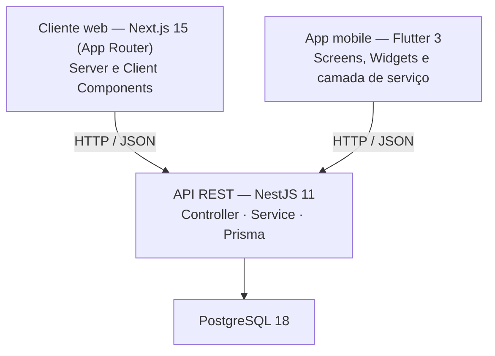

## 1. Objetivo do produto

O sistema permitirá o gerenciamento de eventos, lotes, vagas e inscrições, além do controle de presença dos participantes. O organizador utilizará o cliente web para administrar eventos, lotes, inscrições e acompanhar o comparecimento. A recepção utilizará o aplicativo mobile para localizar participantes e registrar o check-in, enquanto o participante poderá consultar sua inscrição e seu código de identificação.

---

## 2. Personas

### Persona 1 — Ana, 35 anos, organizadora de eventos

- **Contexto:** Ana é responsável pela organização de eventos e precisa controlar eventos, lotes, vagas, inscrições e presença dos participantes.
- **Cliente principal:** web
- **Objetivo principal no sistema:** Gerenciar eventos, lotes e inscrições e acompanhar o comparecimento dos participantes.
- **Maior frustração atual (sem o sistema):** Precisar controlar informações de eventos, inscrições e presença por processos manuais ou informações espalhadas.
- **Critério de sucesso:** Conseguir administrar as informações do evento e acompanhar o comparecimento em um único sistema.

### Persona 2 — Carlos, 24 anos, recepcionista

- **Contexto:** Carlos atua na recepção de um evento e precisa atender vários participantes durante o período de entrada.
- **Cliente principal:** mobile
- **Objetivo principal no sistema:** Localizar rapidamente a inscrição de um participante e registrar seu check-in.
- **Maior frustração atual (sem o sistema):** Demorar para localizar a inscrição ou registrar incorretamente a entrada de um participante.
- **Critério de sucesso:** Encontrar a inscrição por nome ou código e registrar o check-in de forma rápida e correta.

### Persona 3 — Júlia, 22 anos, participante

- **Contexto:** Júlia está inscrita em um evento e utiliza seu celular para consultar sua inscrição e apresentar seu código durante o credenciamento.
- **Cliente principal:** mobile
- **Objetivo principal no sistema:** Consultar sua inscrição e seu código de identificação.
- **Maior frustração atual (sem o sistema):** Ter dificuldade para localizar as informações necessárias para sua entrada no evento.
- **Critério de sucesso:** Acessar rapidamente sua inscrição e apresentar seu código no momento do credenciamento.

---

## 3. Requisitos funcionais

### 3.1 Autenticação e sessão

| ID | Descrição | Prioridade | Persona | Cliente |
|---|---|---|---|---|
| RF-001 | O usuário entra no sistema informando e-mail e senha e recebe acesso às funcionalidades permitidas para seu perfil. | Alta | todas | web / mobile |
| RF-002 | O usuário encerra a sessão e deixa de ter acesso às funcionalidades protegidas. | Alta | todas | web / mobile |

Os usuários serão previamente cadastrados pelo sistema. Não haverá auto-cadastro no MVP.

### 3.2 Gerenciamento de eventos e lotes

| ID | Descrição | Prioridade | Persona | Cliente |
|---|---|---|---|---|
| RF-010 | O organizador pode cadastrar um evento informando nome, descrição, local e data. | Alta | organizador | web |
| RF-011 | O organizador pode consultar os eventos cadastrados e visualizar os dados de um evento. | Alta | organizador | web |
| RF-012 | O organizador pode atualizar os dados de um evento. | Média | organizador | web |
| RF-013 | O organizador pode cadastrar um lote vinculado a um evento, informando nome, quantidade de vagas e período de validade. | Alta | organizador | web |
| RF-014 | O organizador pode consultar os lotes vinculados a um evento. | Alta | organizador | web |
| RF-015 | O organizador pode atualizar os dados de um lote. | Média | organizador | web |

### 3.3 Inscrições e lista de espera

| ID | Descrição | Prioridade | Persona | Cliente |
|---|---|---|---|---|
| RF-020 | O organizador pode cadastrar uma inscrição de participante vinculada a um evento e a um lote. | Alta | organizador | web |
| RF-021 | O sistema gera automaticamente um código único para cada inscrição. | Alta | organizador / participante | web / mobile |
|| RF-022 | Quando não houver vaga disponível no lote, uma nova inscrição poderá receber o status `LISTA_ESPERA`. | Alta | organizador | web |
| RF-023 | O organizador pode consultar as inscrições de um evento e sua situação. | Alta | organizador | web |
| RF-024 | O participante pode consultar sua própria inscrição e seu código de identificação. | Alta | participante | mobile |

### 3.4 Credenciamento e check-in

| ID | Descrição | Prioridade | Persona | Cliente |
|---|---|---|---|---|
| RF-030 | A recepção pode buscar uma inscrição pelo nome do participante ou pelo código único. | Alta | recepcionista | mobile |
| RF-031 | A recepção pode registrar o check-in de uma inscrição válida. | Alta | recepcionista | mobile |
| RF-032 | O sistema impede que uma mesma inscrição tenha mais de um check-in. | Alta | recepcionista | mobile |
| RF-033 | O sistema permite consultar a quantidade de participantes que realizaram check-in em um evento. | Alta | organizador / recepcionista | web / mobile |
| RF-034 | O organizador pode consultar informações de comparecimento do evento. | Média | organizador | web |

---

## 4. Requisitos não funcionais

| ID | Categoria | Descrição | Critério de aceitação |
|---|---|---|---|
| RNF-001 | Segurança — credenciais | Senhas são armazenadas com hash e nunca em texto puro. | Nenhuma senha legível é armazenada no banco de dados. |
| RNF-002 | Segurança — sessão | O acesso é feito por token JWT com validade definida. | Token expirado é recusado com `401`. |
| RNF-003 | Segurança — rotas | Toda rota protegida exige token válido e respeita o perfil do usuário. | Requisição sem token recebe `401` e perfil sem permissão recebe `403`. |
| RNF-004 | Segurança — segredos | Chaves e credenciais ficam em variáveis de ambiente. | Nenhuma credencial real é versionada no repositório. |
| RNF-005 | Desempenho | A busca de inscrições e o registro de check-in devem responder rapidamente durante o credenciamento. | As operações principais devem apresentar resposta adequada ao uso durante o fluxo de entrada do evento. |
| RNF-006 | Usabilidade | As operações principais devem ser simples e apresentar mensagens claras de sucesso e erro. | A recepção consegue localizar uma inscrição e registrar seu check-in com poucos passos. |
| RNF-007 | Manutenibilidade | As regras de negócio ficam no backend e o acesso aos dados é realizado pelo Prisma. | Os clientes não acessam diretamente o PostgreSQL e as regras de negócio não são duplicadas nos clientes. |
| RNF-008 | Comportamento em rede instável (mobile) | O aplicativo deve informar falhas de comunicação e não considerar um check-in concluído sem confirmação da API. | Em caso de falha de rede, o aplicativo informa o erro e permite nova tentativa sem criar check-ins duplicados. |
| RNF-009 | Consistência | Os dados apresentados pelos clientes devem corresponder aos dados armazenados pela API. | Um check-in realizado pelo mobile aparece nas consultas de comparecimento realizadas pelo web. |

---

## 5. Regras de negócio

| ID | Regra | Validação antecipada no cliente? |
|---|---|---|
| RN-001 | Cada lote pertence a um único evento e possui uma quantidade definida de vagas. | sim |
| RN-002 | A quantidade de inscrições confirmadas de um lote não pode ultrapassar a quantidade de vagas disponível. | sim |
| RN-003 | Quando não houver vaga disponível no lote, uma nova inscrição poderá receber o status `LISTA_ESPERA`. | sim |
| RN-004 | Cada inscrição recebe um código único gerado pelo servidor. | não |
| RN-005 | Uma inscrição com status `LISTA_ESPERA` ou `CANCELADA` não pode realizar check-in. | sim |
| RN-006 | Uma inscrição pode possuir no máximo um check-in. | não |
| RN-007 | O check-in só pode ser registrado para uma inscrição existente e válida para entrada. | sim |
| RN-008 | Repetir o check-in da mesma inscrição não cria um segundo registro nem altera novamente a quantidade de participantes presentes. | não |
| RN-009 | A quantidade de participantes presentes é calculada a partir das inscrições que possuem check-in registrado. | não |
| RN-010 | O código da inscrição é gerado pelo servidor e não pode ser definido pelo cliente. | não |

### Autorização — quem pode o quê

| ID | Regra de autorização | Perfil |
|---|---|---|
| RN-A01 | Pode cadastrar, consultar e atualizar eventos e lotes. | ORGANIZADOR |
| RN-A02 | Pode consultar inscrições e informações de comparecimento dos eventos que administra. | ORGANIZADOR |
| RN-A03 | Pode buscar inscrições e registrar check-ins. | RECEPCIONISTA |
| RN-A04 | Pode consultar a própria inscrição e o próprio código de identificação. | PARTICIPANTE |
| RN-A05 | Não pode alterar eventos, lotes ou inscrições administrativas. | PARTICIPANTE |
| RN-A06 | Não pode acessar funcionalidades administrativas de organizador. | RECEPCIONISTA / PARTICIPANTE |

---

## 6. Modelo de dados

### 6.1 Diagrama ER

```mermaid
erDiagram

    USUARIO {
        int id PK
        string nome
        string email UK
        string tipo
        datetime criadoEm
    }

    EVENTO {
        int id PK
        string nome
        string descricao
        string local
        datetime data
        int organizadorId FK
        datetime criadoEm
    }

    LOTE {
        int id PK
        string nome
        int quantidade
        datetime inicio
        datetime fim
        int eventoId FK
    }

    INSCRICAO {
        int id PK
        string codigo UK
        string status
        datetime criadoEm
        int participanteId FK
        int eventoId FK
        int loteId FK
    }

    CHECKIN {
        int id PK
        datetime realizadoEm
        int inscricaoId FK UK
        int recepcionistaId FK
    }

    USUARIO ||--o{ EVENTO : organiza
    EVENTO ||--o{ LOTE : possui
    EVENTO ||--o{ INSCRICAO : recebe
    LOTE ||--o{ INSCRICAO : possui
    USUARIO ||--o{ INSCRICAO : participa
    INSCRICAO ||--o| CHECKIN : possui
    USUARIO ||--o{ CHECKIN : registra
```

### 6.2 Descrição das entidades

| Entidade | Responsabilidade | Principais atributos |
|---|---|---|
| **Usuario** | Representa os usuários do sistema e seus perfis de acesso. | `id`, `nome`, `email`, `tipo`, `criadoEm` |
| **Evento** | Representa um evento administrado por um organizador. | `id`, `nome`, `descricao`, `local`, `data`, `organizadorId`, `criadoEm` |
| **Lote** | Representa uma divisão das vagas disponíveis de um evento. | `id`, `nome`, `quantidade`, `inicio`, `fim`, `eventoId` |
| **Inscricao** | Representa a inscrição de um participante em um evento e em um lote. | `id`, `codigo`, `status`, `criadoEm`, `participanteId`, `eventoId`, `loteId` |
| **CheckIn** | Representa o registro da entrada de um participante no evento. | `id`, `realizadoEm`, `inscricaoId`, `recepcionistaId` |

A lista de espera será representada pelo campo `status` da entidade `Inscricao`, utilizando o valor `LISTA_ESPERA`, não sendo necessária uma entidade separada no MVP.

---

## 7. Recorte web/mobile

| Funcionalidade | Web | Mobile | Justificativa |
|---|---|---|---|
| Gerenciamento de eventos | ✅ | — | O organizador precisa cadastrar, consultar e atualizar informações do evento em uma interface administrativa. |
| Gerenciamento de lotes e vagas | ✅ | — | O cadastro e o acompanhamento de lotes e vagas fazem parte do gerenciamento administrativo do evento. |
| Gerenciamento de inscrições | ✅ | — | O organizador precisa consultar e administrar as inscrições dos eventos. |
| Lista de espera | ✅ | — | O acompanhamento das inscrições em lista de espera faz parte da administração das vagas do evento. |
| Busca por nome ou código | — | ✅ | A recepção precisa localizar rapidamente uma inscrição durante o atendimento na entrada do evento. |
| Registro de check-in | — | ✅ | O check-in será realizado presencialmente pela recepção durante o credenciamento. |
| Contagem de participantes presentes | ✅ | ✅ | O organizador precisa acompanhar o comparecimento e a recepção pode consultar a quantidade durante o credenciamento. |
| Consulta do próprio ingresso | — | ✅ | O participante utilizará o celular para consultar sua inscrição e apresentar seu código. |
| Contagem de presentes | ✅ | — | O relatório é uma funcionalidade administrativa destinada ao acompanhamento do evento pelo organizador. |

**O que ficou de fora do mobile e por quê:**

O gerenciamento de eventos, lotes, vagas, inscrições, lista de espera e relatórios ficará fora do mobile porque essas funcionalidades pertencem ao contexto administrativo do organizador. O aplicativo mobile será direcionado aos fluxos de recepção e participante durante o credenciamento.

**O que ficou de fora do web e por quê:**

O registro de check-in e a busca rápida de participantes não serão fluxos principais do web porque essas operações acontecem presencialmente na entrada do evento, em um contexto de mobilidade.

**Recorte mobile mínimo (1 a 3 casos de uso, com leitura e escrita na API):**

- Buscar uma inscrição por nome ou código e visualizar seus dados.
- Registrar o check-in de uma inscrição válida.
- Consultar a quantidade de participantes presentes no evento.

---

## 8. Arquitetura da solução

### 8.1 Visão geral dos componentes



### 8.2 Estrutura dos três projetos

| Componente | Desvio em relação ao README | Motivo |
|---|---|---|
| Backend | nenhum | Será utilizada a estrutura de backend prevista para o projeto. |
| Cliente web | nenhum | Será utilizado o Next.js com App Router conforme definido no projeto. |
| App mobile | nenhum | Será utilizada a estrutura prevista para o aplicativo Flutter. |

### 8.3 Módulos e recursos do backend

| Módulo | Recurso do domínio | Endpoints previstos |
|---|---|---|
| `AuthModule` | Autenticação | `POST /auth/login` |
| `EventosModule` | Eventos | `GET /eventos`, `GET /eventos/:id`, `POST /eventos`, `PATCH /eventos/:id` |
| `LotesModule` | Lotes | `GET /eventos/:eventoId/lotes`, `POST /eventos/:eventoId/lotes`, `PATCH /lotes/:id` |
| `InscricoesModule` | Inscrições | `GET /inscricoes`, `GET /inscricoes/:id`, `POST /inscricoes` |
| `CheckinsModule` | Check-in e comparecimento | `GET /inscricoes?busca=`, `POST /inscricoes/:id/checkin`, `GET /eventos/:eventoId/contagem` |

### 8.4 Decisões técnicas por componente

| Componente | Decisão a tomar | Escolha do grupo | Justificativa |
|---|---|---|---|
| Backend | Estratégia de autenticação (JWT simples, com refresh) | JWT simples | Atende à proteção das rotas sem adicionar a complexidade de refresh token ao MVP. |
| Backend | Formato de identificador (uuid, cuid, inteiro) | Inteiro autoincremental | O modelo de dados utiliza identificadores inteiros, simplificando os relacionamentos entre as entidades. |
| Web | Fronteira Server / Client Components | Server Components para consultas e Client Components para formulários e interações | Permite utilizar componentes interativos apenas onde são necessários. |
| Web | Estratégia de revalidação e cache | Revalidação após operações de alteração | Permite que as informações exibidas sejam atualizadas após alterações realizadas pelo usuário. |
| Mobile | Gerência de estado (`setState`, Provider, Riverpod, Bloc) | `setState` | O recorte mobile possui poucos fluxos e uma solução simples atende ao escopo do MVP. |
| Mobile | Nível de autenticação e armazenamento do token | Simplificada | O login será realizado contra a API e o token ficará em memória durante a sessão. |

### 8.5 Tecnologias e versões

| Tecnologia | Versão | Papel |
|---|---|---|
| Node.js | 22 LTS | Runtime do backend |
| NestJS | 11 | Framework da API |
| Prisma | 7 (com `@prisma/adapter-pg`) | ORM e migrations |
| PostgreSQL | 18 | Banco de dados |
| React | 19 | Biblioteca de interface |
| Next.js | 15 (App Router) | Framework do cliente web |
| Flutter / Dart | 3 | Framework do app mobile |
| Docker | conforme ambiente do grupo | Execução local do PostgreSQL |

---

## 9. Planejamento de sprints

| Sprint | Etapa | Tema | Requisitos previstos | Responsáveis | Entregáveis |
|---|---|---|---|---|---|
| 1 | Etapa 1 | Contrato e fundação | Definição dos requisitos, modelo de dados e contrato da API | todos | PRD, contrato e backend rodando |
| 2 | Etapa 2 | Backend — eventos e lotes | RF-010 a RF-015 | Maria/Joao | Recursos de eventos e lotes funcionando |
| 3 | Etapa 2 / 3 | Backend — inscrições e check-in | RF-020 a RF-034 |  | Endpoints do MVP respondendo e início do consumo pelo web |
| 4 | Etapa 3 | Cliente web | RF-010 a RF-034 aplicáveis ao web | Maria/Joao | Fluxo principal navegável no navegador |
| 5 | Etapa 4 | App mobile | RF-024, RF-030, RF-031 e RF-033 |  | Recorte mobile funcionando no emulador |
| 6 | Etapa 5 | Integração e fechamento | Requisitos de prioridade Alta | Maria/Joao | Integração dos três componentes, ajustes finais, relatório e entrega |

As etapas 2, 3 e 4 poderão apresentar sobreposição, permitindo que os clientes sejam desenvolvidos enquanto os endpoints correspondentes do backend são implementados

---

## 10. Critérios de aceite (MVP)

- [ ] O organizador consegue cadastrar um evento e consultar seus dados.
- [ ] O organizador consegue atualizar os dados de um evento.
- [ ] O organizador consegue cadastrar um lote vinculado a um evento e definir sua quantidade de vagas.
- [ ] O organizador consegue consultar e atualizar os lotes de um evento.
- [ ] O sistema consegue registrar uma inscrição vinculada a um evento e a um lote.
- [ ] Cada inscrição recebe um código único gerado pelo servidor.
- [ ] Quando não houver vaga disponível no lote, uma nova inscrição pode receber o status `LISTA_ESPERA`.
- [ ] O organizador consegue consultar as inscrições de um evento e sua situação.
- [ ] A recepção consegue buscar uma inscrição pelo nome ou pelo código.
- [ ] A recepção consegue registrar o check-in de uma inscrição válida.
- [ ] Uma inscrição com status `LISTA_ESPERA` ou `CANCELADA` não consegue realizar check-in.
- [ ] Repetir o check-in da mesma inscrição não cria um segundo registro.
- [ ] Repetir o check-in da mesma inscrição não aumenta novamente a quantidade de participantes presentes.
- [ ] A quantidade de participantes presentes é calculada a partir dos registros de check-in.
- [ ] O participante consegue consultar sua própria inscrição e seu código pelo aplicativo mobile.
- [ ] Um evento criado pelo cliente web pode ser consultado por meio da API utilizada pelo aplicativo mobile.
- [ ] Uma inscrição criada pelo cliente web pode ser consultada pelo aplicativo mobile.
- [ ] Um check-in realizado pelo aplicativo mobile aparece nas informações de comparecimento consultadas pelo cliente web.
- [ ] O aplicativo apresenta um token válido à API nas operações protegidas.
- [ ] Usuários sem permissão recebem resposta de autorização adequada da API.

---

## 11. Fora do escopo (explícito)

- Processamento de pagamentos, venda de ingressos, emissão de notas fiscais e integração com sistemas financeiros.
- Divulgação, marketing, transmissão do evento, notificações externas e outras funcionalidades que não estejam diretamente relacionadas ao gerenciamento de inscrições, credenciamento e controle de presença.
- Integração com catracas, leitores físicos de QR Code ou outros equipamentos externos de controle de acesso.
- Auto-cadastro de usuários e recuperação de senha no MVP.
- Gerenciamento administrativo completo de eventos, lotes e inscrições pelo aplicativo mobile.

---

## 12. Histórico de revisões

| Versão | Data | Descrição |
|---|---|---|
| 1.0 | 24/09/2026 | Versão inicial do PRD |